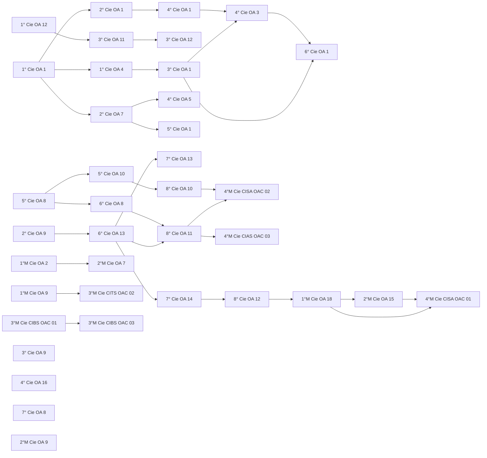

# Progresión

Todo lo que sigue está implementado en `js/motor.js` y probado en `pruebas/motor.test.js`. Los parámetros
viven en `mundos/mundos.json` (`progresion` y `economia`).

## Árbol de objetivos

Cada OA declara sus `prerequisitos`. Un OA está **disponible** cuando cada prerequisito cumple una de estas condiciones:

1. está **dominado**;
2. va en **dificultad 3 o más**, así el jugador no queda bloqueado hasta dominarlo del todo;
3. es de un **nivel escolar anterior** al del jugador: se asume aprendido (un niño de 3° básico no parte por 1°).

Los OA de cursos superiores al del jugador no se muestran como disponibles. Los de cursos anteriores quedan
abiertos para **repasar**. El jugador ve el árbol completo de cada asignatura, con el estado de cada nodo y qué
le falta para abrir los bloqueados.

<!-- inicio:arbol -->
#### Matemática

```mermaid
flowchart LR
  1_basico_matematica_OA1["1° Mat OA 1"] --> 1_basico_matematica_OA4["1° Mat OA 4"]
  1_basico_matematica_OA1["1° Mat OA 1"] --> 1_basico_matematica_OA9["1° Mat OA 9"]
  1_basico_matematica_OA1["1° Mat OA 1"] --> 2_basico_matematica_OA1["2° Mat OA 1"]
  1_basico_matematica_OA4["1° Mat OA 4"] --> 2_basico_matematica_OA3["2° Mat OA 3"]
  1_basico_matematica_OA9["1° Mat OA 9"] --> 2_basico_matematica_OA9["2° Mat OA 9"]
  2_basico_matematica_OA1["2° Mat OA 1"] --> 2_basico_matematica_OA11["2° Mat OA 11"]
  2_basico_matematica_OA9["2° Mat OA 9"] --> 2_basico_matematica_OA11["2° Mat OA 11"]
  2_basico_matematica_OA9["2° Mat OA 9"] --> 3_basico_matematica_OA6["3° Mat OA 6"]
  2_basico_matematica_OA11["2° Mat OA 11"] --> 3_basico_matematica_OA8["3° Mat OA 8"]
  3_basico_matematica_OA8["3° Mat OA 8"] --> 3_basico_matematica_OA9["3° Mat OA 9"]
  3_basico_matematica_OA9["3° Mat OA 9"] --> 3_basico_matematica_OA11["3° Mat OA 11"]
  3_basico_matematica_OA6["3° Mat OA 6"] --> 4_basico_matematica_OA3["4° Mat OA 3"]
  3_basico_matematica_OA8["3° Mat OA 8"] --> 4_basico_matematica_OA5["4° Mat OA 5"]
  3_basico_matematica_OA9["3° Mat OA 9"] --> 4_basico_matematica_OA6["4° Mat OA 6"]
  3_basico_matematica_OA11["3° Mat OA 11"] --> 4_basico_matematica_OA8["4° Mat OA 8"]
  4_basico_matematica_OA5["4° Mat OA 5"] --> 5_basico_matematica_OA3["5° Mat OA 3"]
  4_basico_matematica_OA6["4° Mat OA 6"] --> 5_basico_matematica_OA4["5° Mat OA 4"]
  4_basico_matematica_OA8["4° Mat OA 8"] --> 5_basico_matematica_OA7["5° Mat OA 7"]
  5_basico_matematica_OA3["5° Mat OA 3"] --> 6_basico_matematica_OA1["6° Mat OA 1"]
  5_basico_matematica_OA4["5° Mat OA 4"] --> 6_basico_matematica_OA1["6° Mat OA 1"]
  5_basico_matematica_OA7["5° Mat OA 7"] --> 6_basico_matematica_OA4["6° Mat OA 4"]
  4_basico_matematica_OA3["4° Mat OA 3"] --> 7_basico_matematica_OA1["7° Mat OA 1"]
  6_basico_matematica_OA4["6° Mat OA 4"] --> 7_basico_matematica_OA4["7° Mat OA 4"]
  7_basico_matematica_OA1["7° Mat OA 1"] --> 8_basico_matematica_OA1["8° Mat OA 1"]
  5_basico_matematica_OA3["5° Mat OA 3"] --> 8_basico_matematica_OA3["8° Mat OA 3"]
  8_basico_matematica_OA1["8° Mat OA 1"] --> 8_basico_matematica_OA7["8° Mat OA 7"]
  8_basico_matematica_OA1["8° Mat OA 1"] --> 1_medio_matematica_OA1["1°M Mat OA 1"]
  8_basico_matematica_OA7["8° Mat OA 7"] --> 1_medio_matematica_OA4["1°M Mat OA 4"]
  1_medio_matematica_OA1["1°M Mat OA 1"] --> 2_medio_matematica_OA2["2°M Mat OA 2"]
  8_basico_matematica_OA3["8° Mat OA 3"] --> 2_medio_matematica_OA2["2°M Mat OA 2"]
  1_medio_matematica_OA4["1°M Mat OA 4"] --> 2_medio_matematica_OA4["2°M Mat OA 4"]
  1_medio_matematica_OA14["1°M Mat OA 14"] --> 2_medio_matematica_OA11["2°M Mat OA 11"]
  2_medio_matematica_OA2["2°M Mat OA 2"] --> 3_medio_matematica_OA1["3°M Mat MATE OAC 01"]
  2_medio_matematica_OA11["2°M Mat OA 11"] --> 3_medio_matematica_OA2["3°M Mat MATE OAC 02"]
  2_medio_matematica_OA2["2°M Mat OA 2"] --> 3_medio_matematica_OA3["3°M Mat MATE OAC 03"]
  3_medio_matematica_OA3["3°M Mat MATE OAC 03"] --> 4_medio_matematica_OA1["4°M Mat MATE OAC 01"]
  3_medio_matematica_OA2["3°M Mat MATE OAC 02"] --> 4_medio_matematica_OA2["4°M Mat MATE OAC 02"]
  3_medio_matematica_OA3["3°M Mat MATE OAC 03"] --> 4_medio_matematica_OA3["4°M Mat MATE OAC 03"]
```



#### Lenguaje y Comunicación

```mermaid
flowchart LR
  1_basico_lenguaje_OA3["1° Len OA 3"] --> 1_basico_lenguaje_OA4["1° Len OA 4"]
  1_basico_lenguaje_OA4["1° Len OA 4"] --> 1_basico_lenguaje_OA8["1° Len OA 8"]
  1_basico_lenguaje_OA8["1° Len OA 8"] --> 2_basico_lenguaje_OA5["2° Len OA 5"]
  1_basico_lenguaje_OA4["1° Len OA 4"] --> 2_basico_lenguaje_OA21["2° Len OA 21"]
  2_basico_lenguaje_OA5["2° Len OA 5"] --> 3_basico_lenguaje_OA4["3° Len OA 4"]
  1_basico_lenguaje_OA4["1° Len OA 4"] --> 3_basico_lenguaje_OA20["3° Len OA 20"]
  2_basico_lenguaje_OA21["2° Len OA 21"] --> 3_basico_lenguaje_OA22["3° Len OA 22"]
  3_basico_lenguaje_OA4["3° Len OA 4"] --> 4_basico_lenguaje_OA4["4° Len OA 4"]
  3_basico_lenguaje_OA4["3° Len OA 4"] --> 4_basico_lenguaje_OA10["4° Len OA 10"]
  3_basico_lenguaje_OA22["3° Len OA 22"] --> 4_basico_lenguaje_OA21["4° Len OA 21"]
  4_basico_lenguaje_OA4["4° Len OA 4"] --> 5_basico_lenguaje_OA4["5° Len OA 4"]
  4_basico_lenguaje_OA10["4° Len OA 10"] --> 5_basico_lenguaje_OA12["5° Len OA 12"]
  3_basico_lenguaje_OA20["3° Len OA 20"] --> 5_basico_lenguaje_OA21["5° Len OA 21"]
  4_basico_lenguaje_OA21["4° Len OA 21"] --> 5_basico_lenguaje_OA22["5° Len OA 22"]
  5_basico_lenguaje_OA4["5° Len OA 4"] --> 6_basico_lenguaje_OA4["6° Len OA 4"]
  5_basico_lenguaje_OA21["5° Len OA 21"] --> 6_basico_lenguaje_OA21["6° Len OA 21"]
  6_basico_lenguaje_OA4["6° Len OA 4"] --> 7_basico_lenguaje_OA3["7° Len OA 3"]
  5_basico_lenguaje_OA4["5° Len OA 4"] --> 7_basico_lenguaje_OA4["7° Len OA 4"]
  7_basico_lenguaje_OA3["7° Len OA 3"] --> 8_basico_lenguaje_OA3["8° Len OA 3"]
  7_basico_lenguaje_OA4["7° Len OA 4"] --> 8_basico_lenguaje_OA4["8° Len OA 4"]
  8_basico_lenguaje_OA3["8° Len OA 3"] --> 1_medio_lenguaje_OA3["1°M Len OA 3"]
  8_basico_lenguaje_OA4["8° Len OA 4"] --> 1_medio_lenguaje_OA4["1°M Len OA 4"]
  1_medio_lenguaje_OA3["1°M Len OA 3"] --> 2_medio_lenguaje_OA3["2°M Len OA 3"]
  1_medio_lenguaje_OA9["1°M Len OA 9"] --> 2_medio_lenguaje_OA9["2°M Len OA 9"]
  2_medio_lenguaje_OA3["2°M Len OA 3"] --> 3_medio_lenguaje_OA1["3°M Len LELI OAC 01"]
  1_medio_lenguaje_OA4["1°M Len OA 4"] --> 3_medio_lenguaje_OA1["3°M Len LELI OAC 01"]
  2_medio_lenguaje_OA9["2°M Len OA 9"] --> 3_medio_lenguaje_OA3["3°M Len LELI OAC 03"]
  2_medio_lenguaje_OA18["2°M Len OA 18"] --> 3_medio_lenguaje_OA5["3°M Len LELI OAC 05"]
  2_medio_lenguaje_OA9["2°M Len OA 9"] --> 3_medio_lenguaje_OA5["3°M Len LELI OAC 05"]
  3_medio_lenguaje_OA1["3°M Len LELI OAC 01"] --> 4_medio_lenguaje_OA1["4°M Len LELI OAC 01"]
  3_medio_lenguaje_OA3["3°M Len LELI OAC 03"] --> 4_medio_lenguaje_OA3["4°M Len LELI OAC 03"]
  3_medio_lenguaje_OA5["3°M Len LELI OAC 05"] --> 4_medio_lenguaje_OA4["4°M Len LELI OAC 04"]
```



#### Ciencias Naturales



#### Inglés

```mermaid
flowchart LR
  1_basico_ingles_OA1["1° Ing OA 1"] --> 1_basico_ingles_OA13["1° Ing OA 13"]
  1_basico_ingles_OA1["1° Ing OA 1"] --> 2_basico_ingles_OA1["2° Ing OA 1"]
  1_basico_ingles_OA13["1° Ing OA 13"] --> 2_basico_ingles_OA13["2° Ing OA 13"]
  2_basico_ingles_OA1["2° Ing OA 1"] --> 3_basico_ingles_OA1["3° Ing OA 1"]
  2_basico_ingles_OA13["2° Ing OA 13"] --> 3_basico_ingles_OA13["3° Ing OA 13"]
  3_basico_ingles_OA1["3° Ing OA 1"] --> 4_basico_ingles_OA1["4° Ing OA 1"]
  3_basico_ingles_OA13["3° Ing OA 13"] --> 4_basico_ingles_OA13["4° Ing OA 13"]
  4_basico_ingles_OA1["4° Ing OA 1"] --> 5_basico_ingles_OA5["5° Ing OA 5"]
  4_basico_ingles_OA13["4° Ing OA 13"] --> 5_basico_ingles_OA14["5° Ing OA 14"]
  5_basico_ingles_OA5["5° Ing OA 5"] --> 6_basico_ingles_OA5["6° Ing OA 5"]
  5_basico_ingles_OA14["5° Ing OA 14"] --> 6_basico_ingles_OA15["6° Ing OA 15"]
  6_basico_ingles_OA5["6° Ing OA 5"] --> 7_basico_ingles_OA9["7° Ing OA 9"]
  6_basico_ingles_OA15["6° Ing OA 15"] --> 7_basico_ingles_OA16["7° Ing OA 16"]
  7_basico_ingles_OA9["7° Ing OA 9"] --> 8_basico_ingles_OA9["8° Ing OA 9"]
  7_basico_ingles_OA16["7° Ing OA 16"] --> 8_basico_ingles_OA16["8° Ing OA 16"]
  8_basico_ingles_OA9["8° Ing OA 9"] --> 1_medio_ingles_OA9["1°M Ing OA 9"]
  8_basico_ingles_OA9["8° Ing OA 9"] --> 1_medio_ingles_OA10["1°M Ing OA 10"]
  8_basico_ingles_OA16["8° Ing OA 16"] --> 1_medio_ingles_OA16["1°M Ing OA 16"]
  1_medio_ingles_OA10["1°M Ing OA 10"] --> 2_medio_ingles_OA10["2°M Ing OA 10"]
  1_medio_ingles_OA9["1°M Ing OA 9"] --> 2_medio_ingles_OA11["2°M Ing OA 11"]
  1_medio_ingles_OA16["1°M Ing OA 16"] --> 2_medio_ingles_OA16["2°M Ing OA 16"]
  2_medio_ingles_OA10["2°M Ing OA 10"] --> 3_medio_ingles_OA1["3°M Ing INGL OAC 01"]
  2_medio_ingles_OA11["2°M Ing OA 11"] --> 3_medio_ingles_OA1["3°M Ing INGL OAC 01"]
  2_medio_ingles_OA16["2°M Ing OA 16"] --> 3_medio_ingles_OA2["3°M Ing INGL OAC 02"]
  3_medio_ingles_OA1["3°M Ing INGL OAC 01"] --> 3_medio_ingles_OA3["3°M Ing INGL OAC 03"]
  3_medio_ingles_OA2["3°M Ing INGL OAC 02"] --> 3_medio_ingles_OA3["3°M Ing INGL OAC 03"]
  3_medio_ingles_OA1["3°M Ing INGL OAC 01"] --> 4_medio_ingles_OA1["4°M Ing INGL OAC 01"]
  3_medio_ingles_OA2["3°M Ing INGL OAC 02"] --> 4_medio_ingles_OA2["4°M Ing INGL OAC 02"]
  3_medio_ingles_OA3["3°M Ing INGL OAC 03"] --> 4_medio_ingles_OA3["4°M Ing INGL OAC 03"]
```


<!-- fin:arbol -->

El validador revisa que cada prerequisito exista, que no apunte a un nivel superior y que no haya ciclos.

## Dificultad adaptativa

Cada OA tiene su propio nivel de dificultad (1 a 5) por jugador, y cada desafío del banco tiene el suyo.

- **Acierto** = resolver el desafío al primer intento. Resolverlo al segundo o tercero cuenta como fallo para
  la adaptación, pero igual da monedas.
- **3 aciertos seguidos** suben un nivel.
- **2 fallos seguidos** bajan un nivel.
- Si falla dos seguidos estando ya en nivel 1, el juego sugiere repasar los prerequisitos de ese OA.
- Los desafíos se eligen del nivel actual y no se repiten hasta agotar los de ese nivel.

## Dominio de un objetivo

Un OA queda **dominado** al lograr 3 aciertos seguidos estando en dificultad 5, que es la misma regla de
«subir» aplicada sobre el último nivel. Requiere al menos 15 aciertos, uno por desafío del mínimo del banco,
y entrega **100 monedas** una sola vez.

Un **tramo** es el conjunto de todos los OA de una asignatura en un nivel (por ejemplo, Matemática 2° básico:
OA 1, 3, 9 y 11). Los tramos dominados habilitan las mejoras finales del avatar.

## Sesión

- Una sesión son **10 desafíos** del OA recomendado: el primero disponible y no dominado del curso del jugador,
  en orden de nivel, dificultad del OA y número. El jugador también puede elegir un OA desde el árbol.
- Si domina el OA a mitad de sesión, sigue con el siguiente recomendado.
- Cada desafío admite **3 intentos**: tras el primer error aparece la pista; tras el tercero se muestran la
  respuesta correcta y la explicación del error.
- No hay temporizador ni ranking. Salir a mitad de sesión guarda las monedas ganadas, pero no da el bono de sesión.
- Para 1° y 2° básico el enunciado se lee en voz alta automáticamente (voz del dispositivo, en español).

## Persistencia

`localStorage`, clave `expedicion-saber-v1`. Varios perfiles en el mismo dispositivo, cada uno con su nivel
escolar, sus monedas, su progreso por OA, su racha y un avatar por mundo. El progreso académico y las monedas son
del perfil, así que se comparten entre mundos. El avatar y sus mejoras son propios de cada mundo.

Perfil (resumen):

```json
{
  "id": "p…", "nombre": "León", "nivel_escolar": "3_basico", "mundo": "bloques", "monedas": 130,
  "racha": { "dias": 1, "ultimo": "2026-10-12" },
  "oas": { "3_basico.matematica.OA6": { "nivel": 3, "ok": 0, "fallos": 0, "dominado": false, "vistos": ["…"], "respondidos": 10, "aciertos": 8 } },
  "avatares": { "bloques": { "casco": 1, "armadura": 0, "herramienta": 1, "botas": 0, "estructura": 0 }, "plataformas": { … }, "heroes": { … } }
}
```
